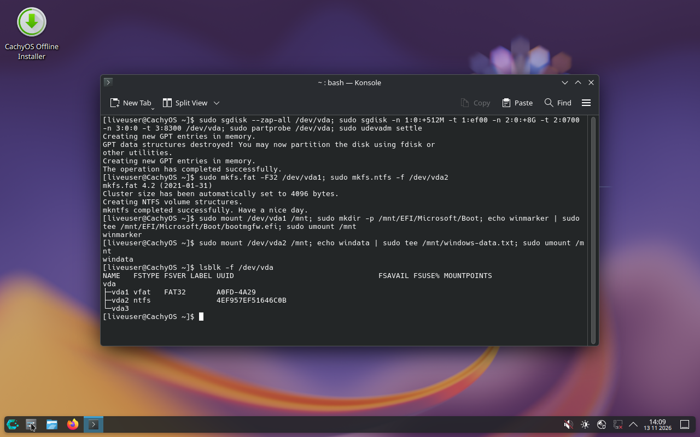

# CachyOS Offline ISO Builder

[English](#english) · [中文](#中文)

A local pacman repository and a shared `pacstrap` installer, delivered as either a portable offline bundle or a self-contained ISO.

本地 pacman 仓库和共用的 `pacstrap` 安装器，提供“独立离线包”和“单 ISO”两种交付方式。

## English

### Scope and validation

The reference target is **Xeon E5-2666 v3 + GT 1030 (Nouveau) + X99 + KDE Plasma**, using x86-64-v3 packages, Chinese locale and Asia/Shanghai timezone. Firmware is deliberately trimmed. This is a hardware-specific installation project; other hardware needs an appropriate package/firmware selection and testing.

Historical release `261113` installed successfully in QEMU with **no network device** (`-nic none`): whole-disk UEFI, whole-disk BIOS, and UEFI coexistence with a seeded ESP + NTFS + empty Linux partition. Those tests reached the installed KDE desktop. They do **not** validate real Windows boot detection, BitLocker, Secure Boot, multiple ESPs, real GPU acceleration or the current revised build pipeline. `scripts/test-iso.sh` and `qmp-tool.py` are VM/interaction helpers; the old end-to-end tests were operator-driven, not unattended CI.

Historical measurements: 684 target packages, about 1.5 GiB repository, 4,789,538,816-byte ISO, 8.27-minute build on an i7-10700F. These measurements describe the older ISO, not a rebuilt image containing the changes below.

### Architecture

```text
explicit release preparation (--refresh NEW_ID)
  ├── target package list + isolated source databases → target local repository
  └── pinned upstream Live package list + isolated source databases → Live local repository
                    ↓ SHA256 + package versions + inputs + upstream commit
              immutable snapshots/NEW_ID + releases/NEW_ID.json
                    ↓
       shared portable bundle (repository + installer + checksums)
          ├── official CachyOS Live ISO + extracted bundle
          └── pinned upstream profile + same bundle → mkarchiso → single ISO
```

The single-ISO build uses only the locked Live repository. It does not run the upstream wrapper, fetch a new mirror list, sync online package repositories, or modify the host's `mkarchiso`. The profile is materialized from the pinned Git tree into `work/profile`; changes in the upstream working tree are not copied.

An x86-64-v4 variant is not provided. The reference i7-10700F build host and E5-2666 v3 target do not support v4; a v4 Live environment would require the full v4 instruction set (including AVX-512) on both the build host and target. Change repository inputs and create a new snapshot for a different architecture.

### Host requirements

- Arch-based host with x86-64-v3 CPU, enough storage for package snapshots, bundle, profile and ISO (allow **40 GiB or more**).
- `pacman`, `archiso`, `python` (3.14+ for zstd tar database reading), `git`, `libarchive`, `dosfstools`, `mtools`, `libisoburn`, `grub`.
- Trusted Arch/CachyOS keyrings and `/etc/pacman.d/{mirrorlist,cachyos-mirrorlist,cachyos-v3-mirrorlist}`.
- `sudo` for preparing new downloads and building ISOs. Snapshot verification and bundle creation need no root privileges.
- Tests additionally use `qemu-system-x86`, `edk2-ovmf`; unit/regression tests need `pacman` and `repo-add`.

### Prepare or restore a release

```bash
git clone https://github.com/gddagdda89/cachyos_offline.git
cd cachyos_offline
git clone https://github.com/CachyOS/CachyOS-Live-ISO.git
git -C CachyOS-Live-ISO checkout 3215497d2e8c5fea90e185affcf973dfa2cf790b

# A deliberate rolling-repository update, using a NEW, unused ID:
./scripts/download-packages.sh --refresh 261113-r2
./scripts/build-repository.sh
```

`--refresh` prepares both target and Live dependencies in separate empty pacman databases, downloads packages/signatures, and creates fresh local repositories in temporary directories. It validates database membership and offline dependency closure before publishing. Extra cached packages, old versions and stale database entries cannot enter the selected release. An existing release ID cannot be overwritten.

Without arguments, `download-packages.sh` only verifies the active snapshot; it never syncs or silently changes versions. `config/release` chooses the active release. `build-repository.sh` verifies it and switches `repo` to its clean target repository. On first migration the old physical `repo/` is retained as `repo.legacy-*`.

The included `261113-r1` metadata was imported from the existing target repository and the earlier ISO's Live pkglist/cache. Its original Live sync databases were unavailable; its exact Live versions and regenerated local databases are preserved instead. The one-time import command is `./scripts/download-packages.sh --import-current NEW_ID`; it requires the old `repo`, `logs/manifest.txt`, `pkg-cache` and built Live pkglist.

**Git contains release metadata, not the package payloads.** To rebuild the same release on another host, archive and restore its materials:

```bash
release=$(cat config/release)
tar -cf "output/CachyOS-build-materials-$release.tar" \
  "snapshots/$release" "releases/$release.json" config/release
# Restore into this repository's root, then:
./scripts/download-packages.sh
```

Package/config/metadata corruption, a changed target list, or an upstream HEAD mismatch stops the build. Keep the committed release lock alongside the materials. Merely changing the release pointer to a metadata file without restoring its snapshot is insufficient.

### Build and use a standalone bundle

```bash
./scripts/build-bundle.sh
# output/CachyOS-Offline-<release>.tar + .tar.sha256
```

Boot an **official CachyOS Live ISO**, mount the disk containing the archive, and extract it onto a Linux filesystem with enough space. The tar is intentionally uncompressed because package files are already compressed. Do not run the installer from your daily system.

```bash
sha256sum -c CachyOS-Offline-261113-r1.tar.sha256
tar -xf CachyOS-Offline-261113-r1.tar
cd CachyOS-Offline-261113-r1
sha256sum -c SHA256SUMS
sudo bash offline-install/offline-install.sh
```

The installer locates the repository relative to itself. No files need to be copied to the Live system's `/opt`, and no online installer is involved. It checks payload checksums and required Live commands before offering disk operations. The official Live environment must support the package format, target CPU and installed keyrings. This delivery path still needs a fresh end-to-end VM/hardware test; creating and validating the archive alone does not prove a successful installation.

### Build a single ISO

```bash
./scripts/build-iso.sh
# output/CachyOS-Offline.iso + .sha256
```

This creates the same bundle, embeds it into a clean profile and invokes `mkarchiso` directly with the locked local Live repository. Package installation failures propagate normally; the final Live pkglist must exactly match the release lock before the ISO is copied to `output`. Each run uses a fresh work directory. Build directories under `work/` are retained for inspection and can be deleted after use when nothing is mounted there.

`SOURCE_DATE_EPOCH` comes from the release metadata. Package versions and bytes are locked, but **bit-for-bit ISO reproducibility is not claimed**: host tools, timestamps and upstream build behavior can still affect the image. Tool versions and the host `mkarchiso` hash are recorded as provenance, not automatically installed/pinned.

### Installation modes

1. **Whole disk:** erases the chosen disk; creates GPT with BIOS boot + 1 GiB ESP + Btrfs; installs BIOS and UEFI GRUB plus EFI fallback.
2. **Coexistence:** formats only the selected Linux root partition; keeps the partition table and other data; never resizes partitions. The selected partition is erased even if it contains an existing Linux system.

Coexistence follows the **Live firmware boot mode**, with checks before formatting:

- UEFI: exactly one explicitly typed ESP on the selected disk, with a FAT filesystem and no existing mount. Arbitrary FAT data partitions are not treated as ESPs. Multiple/cross-disk ESP layouts require manual installation.
- BIOS: a disk containing an ESP is rejected; reboot the medium in UEFI mode. GPT requires an existing BIOS boot partition; MBR/DOS is also supported. The installer does not create missing partitions in coexistence mode.
- `os-prober` is enabled for coexistence. Windows menu creation depends on the actual Windows installation and firmware mode and has not been tested on a real Windows system.

Btrfs subvolumes: `@`, `@home`, `@cache`, `@log`, `@snapshots`, with `noatime,compress=zstd:1`. The repository is copied to `/opt/offline-repo` on the target for offline use.

### After installation: repository modes

Initially only the offline repository is enabled. Once a working connection is available:

```bash
sudo cachyos-repo-mode online
```

This **disables the old offline repository**, enables the CachyOS v3/Arch online repositories and runs a full `pacman -Syu`. If upgrade fails, online mode remains active; fix networking/mirrors and retry `sudo pacman -Syu`. Do not just uncomment online repositories below an enabled old offline repository.

`sudo cachyos-repo-mode offline` disables online repositories, but refuses if installed snapshot packages have changed versions. A newer installed system must not consume an older dependency snapshot. Prepare a new matching snapshot when needed. User edits to `pacman.conf` are not silently overwritten: merge them into `/usr/local/share/cachyos-offline/pacman-{online,offline}.conf` first. The previous configuration is saved as `/etc/pacman.conf.before-mode-switch`.

### Checks

```bash
python3 -m unittest discover -s tests -v
./scripts/test-offline-resolve.sh
./scripts/integrate-offline.sh   # creates the bundle and stages the profile; no root needed
./scripts/test-iso.sh uefi       # boots the existing output ISO; does not rebuild it
./scripts/test-iso.sh bios
```

Regression tests cover dependency closure with extra/old packages, failed publication, missing signatures, duplicate package names, immutable release IDs, changed inputs, checksum tampering, repository configuration switching, and coexistence firmware/layout checks. These are distinct from full installation/boot tests. Keep the old `vm/r2-*` screenshots as historical evidence; they do not certify revised scripts or newly generated artifacts.

### Layout

- `config/`: target packages, download configuration, active release ID.
- `releases/`: tracked package/version/hash locks.
- `snapshots/`: untracked immutable packages, signatures, source databases, input files and local repositories; archive separately.
- `installer/`: shared installer, repository mode helper and boot policy.
- `scripts/`: release preparation/verification, bundle/ISO builds, VM helpers.
- `tests/`: regression tests that do not operate on real disks.
- `output/`, `work/`, `repo.legacy-*`: generated artifacts and retained migration backup.
- `logs/operations.md`, `vm/`: operational history and historical test evidence.

## 中文

### 定位与验证边界

本项目针对 **E5-2666 v3 + GT 1030（Nouveau）+ X99 + KDE Plasma**，使用 x86-64-v3 包、中文环境和上海时区。固件经过裁剪；其它硬件需调整包清单并重新验证。

旧版 `261113` 已完成无网卡（`-nic none`）QEMU 测试：整盘 UEFI、整盘 BIOS、预置 ESP + NTFS + 空 Linux 分区的 UEFI 共存安装，均进入已安装 KDE 桌面。**这不等于实测了真实 Windows 启动项、BitLocker、Secure Boot、多 ESP 或实体显卡加速，也不代表新版流水线已通过整机安装测试。** VM/QMP 脚本是操作辅助工具，旧测试由操作者驱动，并非全自动 CI。

旧版测量值：684 个目标包、约 1.5 GiB 仓库、4,789,538,816 字节 ISO、i7-10700F 上构建 8.27 分钟。这些数字不是本次改动后重新构建的结果。

### 共用核心，两种交付

- **独立离线包**：仓库 + 安装器 + 版本信息 + 校验清单。启动官方 CachyOS Live ISO 后解包运行。
- **单 ISO**：把同一份离线包嵌入固定上游 profile，再用锁定的 Live 本地仓库运行 `mkarchiso`。

ISO 构建不再执行会上网抓取镜像列表、修改主机 `mkarchiso` 的上游包装脚本。profile 从固定 Git commit 直接生成到 `work/profile`，不复制上游工作区的手工改动。

本项目不提供 v4 成品。参考构建机 i7-10700F 和目标 E5-2666 v3 都不支持 v4；若连 Live 环境也改为 v4，构建机与目标机都需要完整 v4 指令集（含 AVX-512）。更换架构必须调整仓库输入并创建新快照。

### 准备发布快照

环境：Arch 系主机、v3 CPU、建议至少 40 GiB 可用空间；安装 `pacman archiso python git libarchive dosfstools mtools libisoburn grub`。Python 需 3.14+。准备可信 Arch/CachyOS 密钥环和 `/etc/pacman.d/` 下的 Arch、CachyOS、v3 镜像列表。

```bash
git clone https://github.com/gddagdda89/cachyos_offline.git
cd cachyos_offline
git clone https://github.com/CachyOS/CachyOS-Live-ISO.git
git -C CachyOS-Live-ISO checkout 3215497d2e8c5fea90e185affcf973dfa2cf790b

# 显式更新：必须使用从未发布过的新编号
./scripts/download-packages.sh --refresh 261113-r2
./scripts/build-repository.sh
```

`--refresh` 为目标系统、Live 系统分别使用空数据库，解析依赖并下载包和签名；只把选定清单放入临时仓库，从零生成数据库，核对成员和离线依赖闭包后才发布。旧版本、多余缓存和历史数据库条目不会混入。已有编号禁止覆盖。

不带参数的 `download-packages.sh` **只验证，不联网刷新**。`config/release` 指定当前快照；`build-repository.sh` 校验后让 `repo` 指向该快照的干净目标仓库。第一次迁移会保留旧目录为 `repo.legacy-*`。

本仓库的 `261113-r1` 从现有目标仓库和旧 ISO 的 Live pkglist/缓存导入。旧 Live 原始同步数据库已经丢失，因此保存精确已装版本和重新生成的本地数据库，不伪称恢复了原数据库。首次迁移入口为 `--import-current 新编号`，需要旧 `repo`、manifest、缓存和已构建 Live pkglist。

**Git 只保存元数据，不保存包文件。** 复建同一版本必须保留 `snapshots/<编号>`、对应 `releases/<编号>.json` 和 `config/release`。可按英文部分的 `tar` 命令归档整个构建材料，再在其它主机恢复。普通构建会核对 SHA256、包输入和上游 commit；不一致就停止。

### 生成与使用独立离线包

```bash
./scripts/build-bundle.sh
# output/CachyOS-Offline-<编号>.tar 和 .tar.sha256
```

启动官方 CachyOS Live ISO，把归档解压到空间足够的 Linux 文件系统。包文件已经压缩，因此外层 tar 不再重复压缩。**不要在日常系统中运行安装器。**

```bash
sha256sum -c CachyOS-Offline-261113-r1.tar.sha256
tar -xf CachyOS-Offline-261113-r1.tar
cd CachyOS-Offline-261113-r1
sha256sum -c SHA256SUMS
sudo bash offline-install/offline-install.sh
```

安装器相对自身定位仓库，无需修改 Live 的 `/opt`，也不调用官方在线安装器。磁盘操作前先验证离线包与必需命令。官方 Live 的包格式支持、密钥环和 CPU 兼容性仍须满足要求；**此独立交付路径仍需新增端到端安装验证，归档校验不能代替实装。**

### 生成单 ISO

```bash
./scripts/build-iso.sh
```

生成同一份离线包并嵌入 profile；直接执行 `mkarchiso`，只使用已锁定 Live 仓库。构建使用全新工作目录，失败正常返回非零，最后核对 Live pkglist 与版本锁完全一致才发布 ISO。

产物为 `output/CachyOS-Offline.iso` 和 `.sha256`；`work/` 保留构建目录供排错。确认无挂载后可删除。`SOURCE_DATE_EPOCH` 固定为发布元数据中的值；**包版本和内容已锁定，但不承诺 ISO 字节级一致**。宿主工具版本和 `mkarchiso` 哈希只记录来源，并未自动安装固定版本。

### 安装和联网切换

整盘模式清空所选磁盘并创建 GPT、BIOS boot、1 GiB ESP 和 Btrfs，同时安装 BIOS/UEFI GRUB。共存模式只格式化选定 Linux root，保留分区表和其它分区，不提供缩容；选中的旧 Linux 系统同样会被擦除。

共存模式在格式化前验证：

- UEFI：所选盘必须恰好一个有明确 ESP 类型的 FAT 分区，且未挂载；普通 FAT 数据分区不当作 ESP。多 ESP、跨盘 ESP 布局需手动安装。
- BIOS：发现 ESP 就停止，要求改用 UEFI 启动介质；GPT 必须已有 BIOS boot 分区；也支持 MBR/DOS。共存模式不会补建分区。
- 按 **Live 实际固件模式**选择引导方式。启用 `os-prober`，但不保证未经实测的真实 Windows 一定生成启动项。

安装后默认仅启用离线仓库。联网后执行：

```bash
sudo cachyos-repo-mode online
```

该命令禁用旧离线仓库、启用 CachyOS v3/Arch 在线仓库，并执行完整 `pacman -Syu`。失败后保留在线模式，修复网络/镜像再运行 `sudo pacman -Syu`，避免旧快照遮住在线新包。

`sudo cachyos-repo-mode offline` 会关闭在线仓库；若已安装的快照包版本发生变化，则拒绝切回旧仓库，需要准备匹配的新快照。手工修改过 `pacman.conf` 时不会直接覆盖，请先把修改合并到 `/usr/local/share/cachyos-offline/pacman-{online,offline}.conf`；原配置备份为 `/etc/pacman.conf.before-mode-switch`。

### 检查与历史证据

```bash
python3 -m unittest discover -s tests -v
./scripts/test-offline-resolve.sh
./scripts/integrate-offline.sh
```

回归测试覆盖旧包/多余包隔离、依赖缺失、发布失败保留原仓库、签名缺失、重复包名、快照不可覆盖、输入漂移、内容篡改、仓库切换和共存引导布局。无需操作真实磁盘。ISO 的安装/重启测试仍使用 `test-iso.sh` 和 QMP 工具另行执行；它们启动的是现有 ISO，不会自动重建。

历史截图：





本工具包含清盘和格式化功能，请核对所选设备并备份数据。本文档由 AI 辅助维护；验证结论按具体版本和实际运行记录区分。
