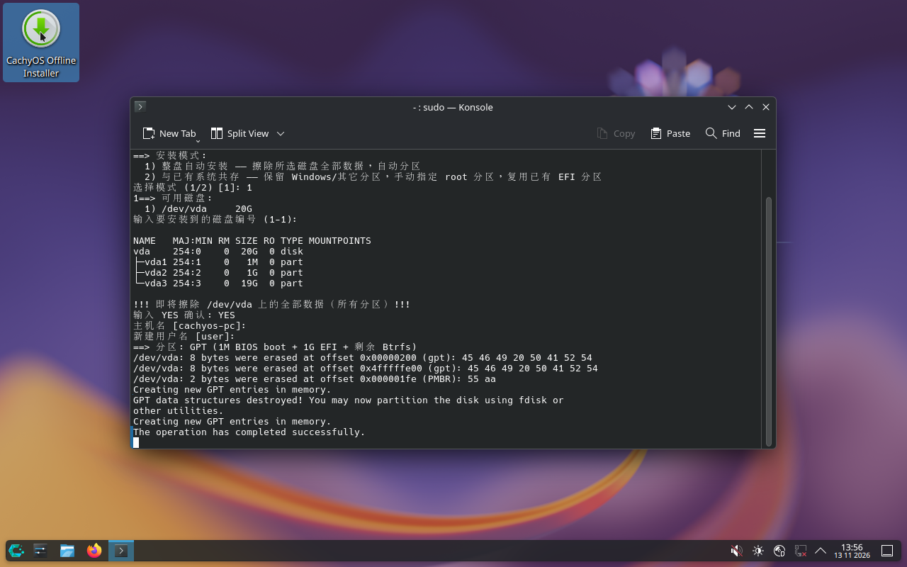
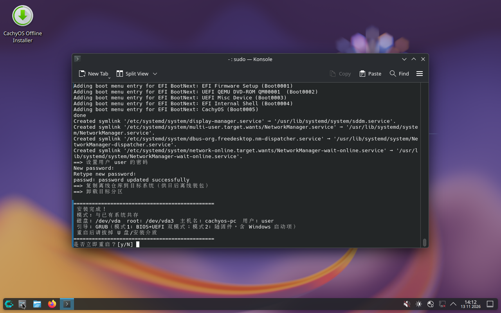
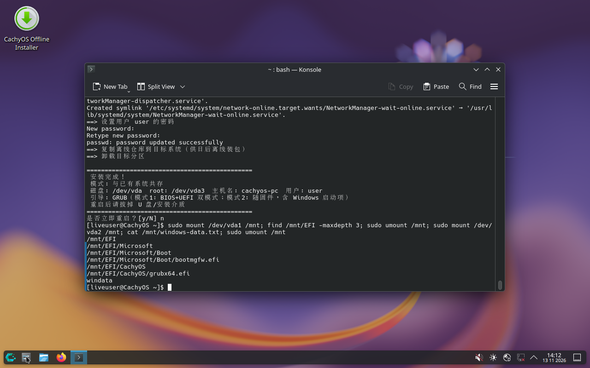
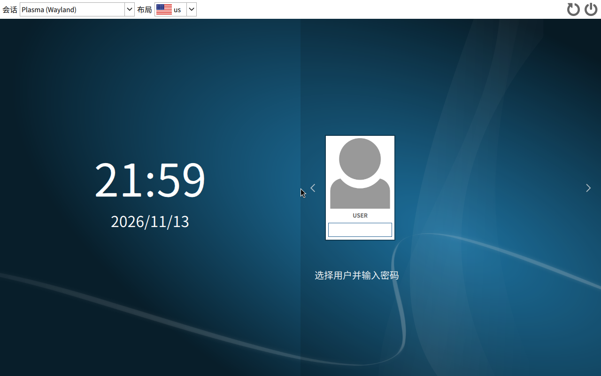

# CachyOS Offline ISO Builder

**完全离线的 CachyOS 安装 ISO 构建工程** · A reproducible pipeline for building fully offline CachyOS installation ISOs

[English](#english) | [中文](#中文) | [Screenshots / 截图](#screenshots)


Build a CachyOS (KDE Plasma) installation ISO that installs a complete system **without any network connection** — every package ships inside the ISO. The bundled installer supports both **whole-disk automatic installation** and **coexistence with an existing Windows installation** (dual boot).

构建一张**无需任何网络连接**即可完整安装 CachyOS（KDE Plasma）的安装 ISO——所有包都随 ISO 附带。内置安装器同时支持**整盘自动安装**与**和已有 Windows 共存**（双系统）两种模式。

---

<a id="english"></a>

## English

**Contents:** [What is this?](#what-is-this) · [Features](#features) · [How it works](#how-it-works) · [Requirements](#requirements) · [Build process](#build-process) · [Using the installer](#using-the-installer) · [After installation](#after-installation) · [Automated testing](#automated-testing) · [Repository layout](#repository-layout) · [Reproducibility](#reproducibility-notes) · [FAQ](#faq) · [Disclaimer](#disclaimer)

### What is this?

The official CachyOS live ISO ships an online installer ("CachyOS Hello") that refuses to run without internet. This project turns the official live profile into a self-contained offline installer:

- a pinned, version-locked **offline package repository** (684 packages, 1.5 GiB) embedded in the ISO;
- a **dual-mode text installer** that pacstraps the target system from that repository;
- a **QEMU test harness** that verifies the whole flow with networking disabled (`-nic none`).

The result is a single 4.5 GiB ISO, Ventoy-friendly, that installs a Chinese-localized KDE Plasma desktop on x86-64-v3 machines — UEFI or BIOS — with zero network access.

### Features

- **100% offline installation** — packages, signatures and repo database travel inside the ISO (`/opt/offline-repo`).
- **Dual-mode installer**
  - *Mode 1 — whole disk:* automatic GPT partitioning (1 MiB BIOS boot + 1 GiB ESP + rest Btrfs), dual GRUB (i386-pc + x86_64-efi) with removable-media fallback.
  - *Mode 2 — coexistence:* never touches existing partitions; reuses the Windows ESP **without formatting it**; formats only the root partition you choose; enables `os-prober` so GRUB adds a Windows boot entry.
- **Btrfs by default** — subvolumes `@`, `@home`, `@cache`, `@log`, `@snapshots`, mounted `noatime,compress=zstd:1`.
- **Ready-to-use desktop** — KDE Plasma (Wayland), SDDM, NetworkManager, PipeWire, Firefox, fcitx5 + Chinese addons, Noto CJK fonts; `zh_CN.UTF-8` locale, `Asia/Shanghai` timezone.
- **Offline after install too** — the repository is copied to the installed system (`/opt/offline-repo`) and wired into `pacman.conf`; online repos stay commented out until you want them.
- **Reproducible** — upstream profile pinned to a commit, exact package version manifest kept in `logs/manifest.txt`.
- **Verified** — automated no-network QEMU tests for UEFI, BIOS and Windows-coexistence installs (see [Automated testing](#automated-testing)).

### How it works

```
config/packages.txt ──► scripts/download-packages.sh ──► repo/ (684 pkgs + .sig)
                              (pacman -Sw, v3 repos)          │
                                                              ▼
                                              scripts/build-repository.sh
                                                   (repo-add offline.db)
                                                              │
CachyOS-Live-ISO/ (upstream, pinned) ◄── scripts/integrate-offline.sh
        │  airootfs/opt/offline-repo + offline-install + desktop entry + hook
        ▼
scripts/build-iso.sh ──► official buildiso.sh (mkarchiso) ──► output/CachyOS-Offline.iso
                                                              │
                       boot live (Ventoy / USB / QEMU)        ▼
                       /opt/offline-install/offline-install.sh
                         mode 1: wipe + auto-partition ─┐
                         mode 2: reuse ESP, pick root ──┴─► pacstrap from /opt/offline-repo
                                                            ─► GRUB, users, services ─► reboot
```

### Requirements

**Build host**

| Item | Requirement |
|---|---|
| OS | Any Arch-based distro (CachyOS, Arch Linux, EndeavourOS, …) |
| CPU | x86-64-v3 capable (Haswell / Excavator or newer) — build-time chroot hooks execute v3 binaries |
| Disk | ~25 GiB free (repo 1.5 G + build cache 2.7 G + work dir ~9 G + ISO 4.5 G) |
| Packages | `archiso`, `dosfstools`, `mtools`, `libisoburn`, `grub`; for tests: `qemu-system-x86`, `edk2-ovmf`, `python3` |
| Privilege | `sudo` for download / build steps (scripts invoke it themselves) |

**Target machine** — x86-64-v3 CPU, ≥ 4 GiB RAM, UEFI or BIOS. Example reference target: Xeon E5-2666 v3 + GT 1030 (Nouveau) + X99 board.

> [!NOTE]
> Non-Arch Linux hosts cannot run `mkarchiso` natively; an Arch container with `--privileged` works in principle but is untested here.

### Build process

The whole build is four commands; everything lands inside the project directory (nothing is written to host system dirs except the upstream-idempotent `mkarchiso` patch).

```bash
git clone https://github.com/gddagdda89/cachyos_offline.git
cd cachyos_offline

# upstream live profile, pinned for reproducibility
git clone https://github.com/CachyOS/CachyOS-Live-ISO.git
git -C CachyOS-Live-ISO checkout 3215497d2e8c5fea90e185affcf973dfa2cf790b

sudo pacman -S archiso dosfstools mtools libisoburn grub   # build toolchain
./scripts/download-packages.sh   # sudo: sync DBs + download all packages
./scripts/build-repository.sh    # repo-add offline.db (no sudo)
./scripts/build-iso.sh           # sudo: integrate + build (~8 min on 8c/16t)
```

**Stage by stage**

| # | Stage | What happens | Artifact | Typical cost |
|---|---|---|---|---|
| 1 | `download-packages.sh` | `pacman -Sy` with an isolated `--dbpath db/`, then `pacman -Sp` resolves the full dependency graph of `config/packages.txt` (60 top-level picks → 684 packages) into `logs/manifest.txt`, then `pacman -Sw --cachedir repo/` downloads packages + `.sig` from CachyOS v3 / Arch repos | `repo/*.pkg.tar.zst`, `logs/manifest.txt` | network-bound, ~1.5 GiB |
| 2 | `build-repository.sh` | `repo-add offline.db.tar.zst repo/*.pkg.tar.zst`, prunes `.old` | `repo/offline.db` | seconds |
| 3 | `integrate-offline.sh` (auto-run by stage 4) | copies `repo/` → `airootfs/opt/offline-repo`; installs installer + `packages.txt` + `pacman-offline.conf` → `airootfs/opt/offline-install`; adds desktop/menu entry; installs the build-time hook that removes Hello autostart; patches `profiledef.sh` permissions and points the profile's pacman `CacheDir` at project-local `pkg-cache/`; verifies the upstream pin | modified upstream profile | seconds (1.5 GiB copy) |
| 4 | `build-iso.sh` | one `sudo` session: official `buildiso.sh -p desktop -v` (mkarchiso: pacstrap live system → run airootfs hooks → mksquashfs → xorriso hybrid ISO), then copies the newest ISO to `output/CachyOS-Offline.iso` and writes `.sha256` | `output/CachyOS-Offline.iso` (4.5 GiB) | ~8 min |

**Inside the ISO build** (mkarchiso order, matters for the hook): `_make_custom_airootfs` → `_make_packages` (pacstrap; our `zz-offline-no-hello-autostart.hook` fires here and deletes Hello's skel autostart) → `_make_customize_airootfs` (skel → home copy, so the live user never gets Hello autostart either). The live system's package cache stays in project-local `pkg-cache/`, so rebuilds reuse it.

**Verified build numbers** (reference run, i7-10700F): 684 packages / 1.5 GiB repo; installed size 4324 MiB; ISO 4,789,538,816 bytes; build 8.27 min; version tag = build date (`261113`).

> [!NOTE]
> The official build script prints `ERROR: An unknown error has occurred. Exiting...` even on success (its EXIT trap). Judge the build by the artifact, not the exit code. `build-iso.sh` already does this: it fails only if no new ISO appeared.

> [!TIP]
> Re-runs are cheap and idempotent: `--needed` skips already-downloaded packages, integrate re-copies cleanly, and `pkg-cache/` survives `build/` cleanup. After a mirror refresh, prune superseded versions from `repo/` and re-run `build-repository.sh` (see `logs/operations.md` for a worked example).

### Using the installer

Boot the ISO, then launch **CachyOS Offline Installer** from the desktop (or run `sudo /opt/offline-install/offline-install.sh` in a terminal).

| | Mode 1 — whole disk | Mode 2 — coexistence |
|---|---|---|
| Existing data | **Erased** (all partitions) | Preserved |
| Partitioning | Automatic GPT | You pick an existing empty partition as root |
| EFI partition | Created (1 GiB) | Reuses existing ESP, **never formats it** |
| GRUB | BIOS + UEFI + fallback | Matches firmware; UEFI keeps Windows boot path intact |
| Windows boot entry | n/a | Added via `os-prober` |

> [!WARNING]
> Mode 1 destroys **all** data on the selected disk. The installer lists disks, excludes the live boot medium, and requires typing `YES` before touching anything.

**Coexistence preparation:** free up space first (Windows Disk Management, or GParted / KDE Partition Manager in the live session). The installer does not resize partitions; it only formats the root partition you select and rejects NTFS/exFAT/FAT/swap/mounted partitions as root candidates. The ESP is auto-detected by GPT type GUID (with a vfat fallback) and mounted, never formatted.

### After installation

- Root + user passwords set during install; user is in `wheel` with sudo.
- `/etc/pacman.conf` enables `[offline]` (`file:///opt/offline-repo/`); CachyOS/Arch online repos are present but commented — uncomment after going online (run `cachyos-rate-mirrors` first).
- The offline repo stays on disk for future offline package installs.
- The install log is preserved at `/var/log/offline-install.log` on the target.

### Automated testing

Everything below runs **with no network device attached to the VM** (`-nic none`), so a successful install proves offline capability. The harness is two files: `scripts/test-iso.sh` (VM lifecycle) and `scripts/qmp-tool.py` (QMP automation, stdlib-only Python).

**VM configuration** — `qemu-system-x86_64 -enable-kvm -cpu host -smp 4 -m 4G -nic none`, 20 GiB qcow2 virtio disk, ISO as cdrom; UEFI via OVMF pflash (`OVMF_CODE.4m.fd` + per-project `OVMF_VARS` copy); `-boot order=d` for live tests (CD first, even if the disk holds an old system) and `order=c` for installed-disk tests; headless (`-display none -daemonize`) with a QMP unix socket per mode.

**QMP tool actions**

| Action | Purpose |
|---|---|
| `shot FILE.png` | framebuffer screenshot (absolute path required) |
| `type 'text'` / `key ret` | keystrokes (full symbol map, incl. shifted chars) |
| `click X Y` / `dclick X Y` | absolute-coordinate pointer events |
| `status` / `powerdown` / `quit` | run state / ACPI shutdown / force stop |

**Test flow (whole-disk, UEFI or BIOS)**

1. `./scripts/test-iso.sh uefi` — creates disk/OVMF vars if missing, boots the live ISO.
2. Poll screenshots until the Plasma desktop appears (~40 s); Hello autostart must be absent.
3. Double-click the desktop installer icon; batch-answer the prompts over QMP: mode `1`, disk `1`, `YES`, default hostname/user (terminal type-ahead makes this safe).
4. pacstrap runs from the ISO repo (~1 min in VM); enter root password twice, then user password twice.
5. Wait for the completion banner (GRUB install, services, repo copy, umount); answer `n` to reboot; `quit`.
6. `./scripts/test-iso.sh disk-uefi` — boot the installed disk; expect SDDM; log in; screenshot the KDE Wayland desktop.

**Coexistence variant** — before step 3, seed a Windows-like layout from the live shell (sudo is NOPASSWD in live):

```bash
sudo sgdisk --zap-all /dev/vda
sudo sgdisk -n 1:0:+512M -t 1:ef00 -n 2:0:+8G -t 2:0700 -n 3:0:0 -t 3:8300 /dev/vda
sudo partprobe /dev/vda; sudo udevadm settle
sudo mkfs.fat -F32 /dev/vda1; sudo mkfs.ntfs -f /dev/vda2
# marker files prove "not formatted / not wiped" later
sudo mount /dev/vda1 /mnt; sudo mkdir -p /mnt/EFI/Microsoft/Boot
echo winmarker | sudo tee /mnt/EFI/Microsoft/Boot/bootmgfw.efi; sudo umount /mnt
sudo mount /dev/vda2 /mnt; echo windata | sudo tee /mnt/windows-data.txt; sudo umount /mnt
```

Then run the installer with mode `2`, root partition `3`. After the completion banner, verify **before rebooting**: ESP still contains `EFI/Microsoft/Boot/bootmgfw.efi` *and* the new `EFI/CachyOS/grubx64.efi`; NTFS still contains `windows-data.txt`; `sgdisk -p` shows the original three partitions/types; target `/etc/default/grub` contains `GRUB_DISABLE_OS_PROBER=false`. Finally boot the installed disk and log in.

**Results (dual-mode regression, all no-network)**

| Scenario | Result |
|---|---|
| Whole-disk install, UEFI | ✅ install → GRUB NVRAM entry → disk boot → SDDM → KDE login |
| Whole-disk install, BIOS | ✅ install → disk boot → SDDM → KDE login |
| Coexistence install, UEFI (seeded ESP + NTFS + empty root) | ✅ partition table untouched, ESP & NTFS markers intact, os-prober enabled, disk boot → KDE login |

Evidence: [Screenshots / 截图](#screenshots) (`vm/r2-*`). An empty NTFS placeholder yields no Windows menu entry — expected; a real Windows installation is detected by `os-prober`.

### Repository layout

```
├── config/           packages.txt (60 top-level picks) + pacman-v3.conf (repo order)
├── installer/        offline-install.sh, pacman-offline.conf, desktop entry, build hook
├── scripts/          download / build-repository / integrate / build-iso / test harness
├── logs/             operations.md (chronological log), manifest.txt (version lock), build logs
├── vm/               test screenshots (qcow2 disks & OVMF vars are gitignored)
├── plan.md           original design document (Chinese)
├── repo/             [gitignored] offline package repository
├── output/           [gitignored] built ISO + sha256
└── CachyOS-Live-ISO/ [gitignored] upstream profile clone (pinned commit)
```

### Reproducibility notes

- Upstream `CachyOS-Live-ISO` pinned to `3215497d2e8c5fea90e185affcf973dfa2cf790b`; `integrate-offline.sh` warns on drift.
- `logs/manifest.txt` records the exact 684 package filenames of the verified build; `scripts/test-offline-resolve.sh` re-validates that the offline repo alone resolves the full dependency graph.
- The official build patches the host `/usr/bin/mkarchiso` (idempotent, upstream behaviour); restore with `sudo pacman -S archiso` if desired.
- The ISO version tag is the build date (`YYMMDD`), set by upstream tooling.

### FAQ

**Why not the official installer?** CachyOS Hello checks for internet and refuses offline installation. This project keeps the official live system but replaces the installation path; Hello's autostart is removed by a build-time hook (its menu entry remains).

**Will GRUB really show Windows?** Yes, when a real Windows installation exists: mode 2 enables `os-prober` and keeps `ntfs-3g` available so `grub-mkconfig` can detect it.

**Can I change the package set / locale / firmware?** Edit `config/packages.txt` (firmware is trimmed for the reference target; add `linux-firmware-intel` etc. as needed), then re-run download → repository → build. Locale/timezone defaults live in `installer/offline-install.sh`.

**Where is the ISO in this repo?** Nowhere — 4.5 GiB exceeds GitHub's limits. Build it locally; `output/` is gitignored.

### Disclaimer

Unofficial community project. Not affiliated with or endorsed by CachyOS or Arch Linux; trademarks belong to their owners. Installation writes to disk — **back up your data**. Mode 1 erases entire disks; mode 2 formats the partition you select. Use at your own risk.

---

<a id="中文"></a>

## 中文

**目录：** [这是什么？](#这是什么) · [特性](#特性) · [工作原理](#工作原理) · [环境要求](#环境要求) · [构建过程](#构建过程) · [安装器使用](#安装器使用) · [安装完成后](#安装完成后) · [自动化测试](#自动化测试) · [目录结构](#目录结构) · [可复现性说明](#可复现性说明) · [常见问题](#常见问题) · [免责声明](#免责声明)

### 这是什么？

官方 CachyOS live ISO 自带的安装器（CachyOS Hello）断网时拒绝工作。本工程把官方 live profile 改造成自包含的离线安装器：

- 版本锁定的**离线包仓库**（684 个包、1.5 GiB）内置于 ISO；
- **双模式文本安装器**，从该仓库 pacstrap 目标系统；
- **QEMU 断网测试 harness**（`-nic none`）验证全流程。

产物是一张 4.5 GiB、兼容 Ventoy 的 ISO：在 x86-64-v3 机器上（UEFI 或 BIOS）零联网安装中文本地化的 KDE Plasma 桌面。

### 特性

- **100% 离线安装**——包、签名、仓库数据库全部随 ISO 携带（`/opt/offline-repo`）。
- **双模式安装器**
  - *模式 1 — 整盘：* 自动 GPT 分区（1 MiB BIOS boot + 1 GiB ESP + 剩余 Btrfs），GRUB 双引导（i386-pc + x86_64-efi）含可移动介质回退。
  - *模式 2 — 共存：* 不动任何已有分区；复用 Windows 的 ESP 且**绝不格式化**；只格式化你选定的 root 分区；启用 `os-prober`，GRUB 自动生成 Windows 启动项。
- **默认 Btrfs**——子卷 `@`、`@home`、`@cache`、`@log`、`@snapshots`，挂载参数 `noatime,compress=zstd:1`。
- **开箱即用桌面**——KDE Plasma（Wayland）、SDDM、NetworkManager、PipeWire、Firefox、fcitx5 + 中文插件、Noto CJK 字体；`zh_CN.UTF-8` 语言、`Asia/Shanghai` 时区。
- **装完仍可离线**——仓库复制到已装系统（`/opt/offline-repo`）并写入 `pacman.conf`；在线仓库默认注释，联网后自行启用。
- **可复现**——上游 profile 固定 commit，精确包版本清单存于 `logs/manifest.txt`。
- **已验证**——UEFI / BIOS / Windows 共存三种断网 QEMU 自动化测试全部通过（见[自动化测试](#自动化测试)）。

### 工作原理

```
config/packages.txt ──► scripts/download-packages.sh ──► repo/（684 包 + 签名）
                              (pacman -Sw, v3 仓库)           │
                                                              ▼
                                              scripts/build-repository.sh
                                                   (repo-add offline.db)
                                                              │
CachyOS-Live-ISO/（上游，固定 commit）◄── scripts/integrate-offline.sh
        │  airootfs/opt/offline-repo + offline-install + 桌面入口 + hook
        ▼
scripts/build-iso.sh ──► 官方 buildiso.sh (mkarchiso) ──► output/CachyOS-Offline.iso
                                                              │
                       live 启动（Ventoy / U 盘 / QEMU）       ▼
                       /opt/offline-install/offline-install.sh
                         模式 1：擦盘 + 自动分区 ─┐
                         模式 2：复用 ESP、选 root ─┴─► 从 /opt/offline-repo pacstrap
                                                            ─► GRUB、用户、服务 ─► 重启
```

### 环境要求

**构建机**

| 项目 | 要求 |
|---|---|
| 系统 | 任意 Arch 系发行版（CachyOS、Arch Linux、EndeavourOS 等） |
| CPU | 支持 x86-64-v3（Haswell / Excavator 及以后）——构建期 chroot hook 会执行 v3 二进制 |
| 磁盘 | 约 25 GiB 空闲（repo 1.5 G + 构建缓存 2.7 G + 工作目录 ~9 G + ISO 4.5 G） |
| 软件 | `archiso`、`dosfstools`、`mtools`、`libisoburn`、`grub`；测试另需 `qemu-system-x86`、`edk2-ovmf`、`python3` |
| 权限 | 下载/构建步骤需要 `sudo`（脚本内部自行调用） |

**目标机**——x86-64-v3 CPU、≥ 4 GiB 内存、UEFI 或 BIOS。参考目标机：Xeon E5-2666 v3 + GT 1030（Nouveau）+ X99 主板。

> [!NOTE]
> 非 Arch 的 Linux 无法原生运行 `mkarchiso`；理论上可用 `--privileged` 的 Arch 容器，但本工程未验证。

### 构建过程

整个构建四条命令；所有产物都落在项目目录内（除上游幂等的 `mkarchiso` 补丁外不写宿主系统目录）。

```bash
git clone https://github.com/gddagdda89/cachyos_offline.git
cd cachyos_offline

# 上游 live profile，固定 commit 保证可复现
git clone https://github.com/CachyOS/CachyOS-Live-ISO.git
git -C CachyOS-Live-ISO checkout 3215497d2e8c5fea90e185affcf973dfa2cf790b

sudo pacman -S archiso dosfstools mtools libisoburn grub   # 构建工具链
./scripts/download-packages.sh   # 需 sudo：同步数据库 + 下载全部包
./scripts/build-repository.sh    # repo-add 生成 offline.db（无需 sudo）
./scripts/build-iso.sh           # 需 sudo：集成 + 构建（8 核 16 线程约 8 分钟）
```

**分阶段说明**

| # | 阶段 | 做什么 | 产物 | 典型耗时 |
|---|---|---|---|---|
| 1 | `download-packages.sh` | 用独立 `--dbpath db/` 执行 `pacman -Sy`；`pacman -Sp` 把 `config/packages.txt`（60 个顶层选择）解析成完整依赖图（684 包）写入 `logs/manifest.txt`；再 `pacman -Sw --cachedir repo/` 从 CachyOS v3 / Arch 仓库下载包与 `.sig` | `repo/*.pkg.tar.zst`、`logs/manifest.txt` | 取决于网速，约 1.5 GiB |
| 2 | `build-repository.sh` | `repo-add offline.db.tar.zst repo/*.pkg.tar.zst`，清理 `.old` | `repo/offline.db` | 秒级 |
| 3 | `integrate-offline.sh`（阶段 4 自动调用） | `repo/` → `airootfs/opt/offline-repo`；安装器 + `packages.txt` + `pacman-offline.conf` → `airootfs/opt/offline-install`；桌面/菜单入口；移除 Hello 自启动的构建期 hook；补 `profiledef.sh` 权限、把 profile 的 pacman `CacheDir` 指向项目内 `pkg-cache/`；校验上游 commit | 改造后的上游 profile | 秒级（1.5 GiB 复制） |
| 4 | `build-iso.sh` | 单个 `sudo` 会话内跑官方 `buildiso.sh -p desktop -v`（mkarchiso：pacstrap live 系统 → 执行 airootfs hook → mksquashfs → xorriso 混合 ISO），再把新 ISO 复制到 `output/CachyOS-Offline.iso` 并生成 `.sha256` | `output/CachyOS-Offline.iso`（4.5 GiB） | 约 8 分钟 |

**ISO 构建内部顺序**（mkarchiso，与 hook 生效相关）：`_make_custom_airootfs` → `_make_packages`（pacstrap；我们的 `zz-offline-no-hello-autostart.hook` 在此触发，删除 Hello 的 skel 自启动）→ `_make_customize_airootfs`（skel → home 复制，因此 live 用户也不会带 Hello 自启动）。live 系统的包缓存留在项目内 `pkg-cache/`，重建可复用。

**实测构建数据**（参考机 i7-10700F）：684 包 / 1.5 GiB 仓库；安装后占用 4324 MiB；ISO 4,789,538,816 字节；构建 8.27 分钟；版本号 = 构建日期（`261113`）。

> [!NOTE]
> 官方构建脚本即使成功也会打印 `ERROR: An unknown error has occurred. Exiting...`（其 EXIT trap 所致）。请以产物判断成败，不要看退出码——`build-iso.sh` 已如此处理：仅当没有新 ISO 产出时才判失败。

> [!TIP]
> 重跑便宜且幂等：`--needed` 跳过已下载的包；integrate 干净重拷；`pkg-cache/` 不受 `build/` 清理影响。镜像源刷新后请从 `repo/` 删除被取代的旧版本再重跑 `build-repository.sh`（`logs/operations.md` 有完整实例）。

### 安装器使用

启动 ISO 后，双击桌面 **CachyOS Offline Installer**（或终端运行 `sudo /opt/offline-install/offline-install.sh`）。

| | 模式 1 — 整盘 | 模式 2 — 共存 |
|---|---|---|
| 已有数据 | **全部擦除** | 保留 |
| 分区 | 自动 GPT | 手动指定一个空分区作为 root |
| EFI 分区 | 新建 1 GiB | 复用已有 ESP，**绝不格式化** |
| GRUB | BIOS + UEFI + 回退 | 随固件而定；UEFI 下保留 Windows 引导路径 |
| Windows 启动项 | 无 | `os-prober` 自动生成 |

> [!WARNING]
> 模式 1 会销毁所选磁盘上的**全部**数据。安装器会列出磁盘、排除 live 启动盘，并要求输入 `YES` 才会动盘。

**共存准备：** 先腾出空闲空间（Windows 磁盘管理，或 live 会话里的 GParted / KDE 分区管理器）。安装器**不做分区缩放**，只格式化你选定的 root 分区，并拒绝把 NTFS/exFAT/FAT/swap/已挂载分区选作 root。ESP 按 GPT 类型 GUID 自动探测（回退 vfat 识别），只挂载、不格式化。

### 安装完成后

- 安装过程中设置 root 与用户密码；用户加入 `wheel` 组并启用 sudo。
- `/etc/pacman.conf` 启用 `[offline]`（`file:///opt/offline-repo/`）；CachyOS/Arch 在线仓库已写入但默认注释——联网后取消注释即可（建议先跑 `cachyos-rate-mirrors`）。
- 离线仓库保留在硬盘上，日后仍可离线装包。
- 安装日志留存于目标系统 `/var/log/offline-install.log`。

### 自动化测试

以下全部在**虚拟机无网络设备**（`-nic none`）下运行——安装成功即证明离线能力。harness 由两个文件组成：`scripts/test-iso.sh`（虚拟机生命周期）与 `scripts/qmp-tool.py`（QMP 自动化，仅 Python 标准库）。

**虚拟机配置**——`qemu-system-x86_64 -enable-kvm -cpu host -smp 4 -m 4G -nic none`；20 GiB qcow2 virtio 磁盘；ISO 作光驱；UEFI 用 OVMF pflash（`OVMF_CODE.4m.fd` + 项目内 `OVMF_VARS` 副本）；live 测试 `-boot order=d`（光驱优先，即使盘上有旧系统）、已装盘测试 `order=c`；无头运行（`-display none -daemonize`），每模式一个 QMP unix socket。

**QMP 工具动作**

| 动作 | 用途 |
|---|---|
| `shot FILE.png` | 帧缓冲截图（必须绝对路径） |
| `type 'text'` / `key ret` | 按键输入（完整符号映射，含 shift 组合） |
| `click X Y` / `dclick X Y` | 绝对坐标指针事件 |
| `status` / `powerdown` / `quit` | 运行状态 / ACPI 关机 / 强制停止 |

**测试流程（整盘，UEFI 或 BIOS）**

1. `./scripts/test-iso.sh uefi`——缺磁盘/OVMF 变量则自动创建，从 live ISO 启动。
2. 轮询截图直到 Plasma 桌面出现（约 40 秒）；确认 Hello 自启动不存在。
3. 双击桌面安装器图标；经 QMP 批量应答：模式 `1`、磁盘 `1`、`YES`、默认主机名/用户（终端预输入缓冲使其安全）。
4. pacstrap 从 ISO 仓库装包（虚拟机内约 1 分钟）；输入 root 密码两遍、用户密码两遍。
5. 等待完成横幅（GRUB 安装、服务启用、仓库复制、卸载）；重启询问答 `n`；`quit`。
6. `./scripts/test-iso.sh disk-uefi`——从已安装磁盘启动；应见 SDDM；登录；截图 KDE Wayland 桌面。

**共存变体**——第 3 步之前，在 live shell 里预置类 Windows 布局（live 的 sudo 为 NOPASSWD）：

```bash
sudo sgdisk --zap-all /dev/vda
sudo sgdisk -n 1:0:+512M -t 1:ef00 -n 2:0:+8G -t 2:0700 -n 3:0:0 -t 3:8300 /dev/vda
sudo partprobe /dev/vda; sudo udevadm settle
sudo mkfs.fat -F32 /dev/vda1; sudo mkfs.ntfs -f /dev/vda2
# 标记文件用于事后证明"未格式化 / 未擦除"
sudo mount /dev/vda1 /mnt; sudo mkdir -p /mnt/EFI/Microsoft/Boot
echo winmarker | sudo tee /mnt/EFI/Microsoft/Boot/bootmgfw.efi; sudo umount /mnt
sudo mount /dev/vda2 /mnt; echo windata | sudo tee /mnt/windows-data.txt; sudo umount /mnt
```

随后以模式 `2`、root 分区 `3` 运行安装器。完成横幅后、**重启之前**验证：ESP 中同时存在 `EFI/Microsoft/Boot/bootmgfw.efi` 与新增的 `EFI/CachyOS/grubx64.efi`；NTFS 中 `windows-data.txt` 仍在；`sgdisk -p` 显示原有三个分区及类型；目标系统 `/etc/default/grub` 含 `GRUB_DISABLE_OS_PROBER=false`。最后从已装磁盘启动并登录。

**结果（双模式回归，全部断网）**

| 场景 | 结果 |
|---|---|
| 整盘安装，UEFI | ✅ 安装 → GRUB 写入 NVRAM → 硬盘启动 → SDDM → 登录 KDE |
| 整盘安装，BIOS | ✅ 安装 → 硬盘启动 → SDDM → 登录 KDE |
| 共存安装，UEFI（预置 ESP + NTFS + 空 root） | ✅ 分区表原样、ESP 与 NTFS 标记留存、os-prober 启用、硬盘启动 → 登录 KDE |

证据见 [Screenshots / 截图](#screenshots)（`vm/r2-*`）。空 NTFS 占位分区不产生 Windows 菜单项属预期；真实 Windows 会被 `os-prober` 探测到。

### 目录结构

```
├── config/           packages.txt（60 个顶层选择）+ pacman-v3.conf（仓库顺序）
├── installer/        offline-install.sh、pacman-offline.conf、桌面入口、构建期 hook
├── scripts/          下载 / 建库 / 集成 / 构建 / 测试 harness
├── logs/             operations.md（按时间顺序的操作日志）、manifest.txt（版本锁定）、构建日志
├── vm/               测试截图（qcow2 磁盘与 OVMF 变量已 gitignore）
├── plan.md           原始设计文档（中文）
├── repo/             [gitignore] 离线包仓库
├── output/           [gitignore] 构建产物 ISO + sha256
└── CachyOS-Live-ISO/ [gitignore] 上游 profile 克隆（固定 commit）
```

### 可复现性说明

- 上游 `CachyOS-Live-ISO` 固定于 `3215497d2e8c5fea90e185affcf973dfa2cf790b`；`integrate-offline.sh` 对偏离发出警告。
- `logs/manifest.txt` 记录已验证构建的 684 个包精确文件名；`scripts/test-offline-resolve.sh` 可复验"仅离线仓库"能否解析完整依赖图。
- 官方构建会补丁宿主 `/usr/bin/mkarchiso`（幂等、上游行为）；如需恢复执行 `sudo pacman -S archiso`。
- ISO 版本号为构建日期（`YYMMDD`），由上游工具自动写入。

### 常见问题

**为什么不用官方安装器？** CachyOS Hello 会检查联网并拒绝离线安装。本工程保留官方 live 系统、只替换安装路径；Hello 的自启动由构建期 hook 移除（菜单入口保留）。

**GRUB 真的会出现 Windows 吗？** 会——只要存在真实 Windows：模式 2 启用 `os-prober` 并带 `ntfs-3g`，`grub-mkconfig` 即可探测。

**能改包清单 / 语言 / 固件吗？** 改 `config/packages.txt`（固件按参考目标机裁剪，需要时加 `linux-firmware-intel` 等），再依次跑 下载 → 建库 → 构建。语言/时区默认值在 `installer/offline-install.sh`。

**ISO 在仓库里吗？** 不在——4.5 GiB 超出 GitHub 限制。请本地构建；`output/` 已 gitignore。

### 免责声明

非官方社区工程，与 CachyOS / Arch Linux 无隶属或背书关系；商标归各自所有者。安装会写盘——**请备份数据**。模式 1 擦除整盘，模式 2 格式化所选分区。风险自负。

---

<a id="screenshots"></a>

## Screenshots / 截图

All images below are real captures from the no-network QEMU regression run (`vm/r2-*`).
以下均为断网 QEMU 回归测试的真实截图（`vm/r2-*`）。

**1. Live desktop with the offline installer entry / live 桌面与离线安装器入口**


**2. Mode selection and whole-disk confirmation / 模式选择与整盘确认**



**3. Seeded Windows-like disk before coexistence install (ESP + NTFS + empty root) / 共存安装前预置的类 Windows 磁盘**


**4. Coexistence install completed / 共存模式安装完成**



**5. Post-install proof: Windows ESP marker and NTFS data intact, CachyOS bootloader added alongside / 安装后证据：Windows ESP 标记与 NTFS 数据完好，CachyOS 引导并列写入**



**6. Installed system boots to SDDM / 已安装系统启动到 SDDM**



**7. Logged-in KDE Plasma (Wayland) desktop / 登录后的 KDE Plasma（Wayland）桌面**

